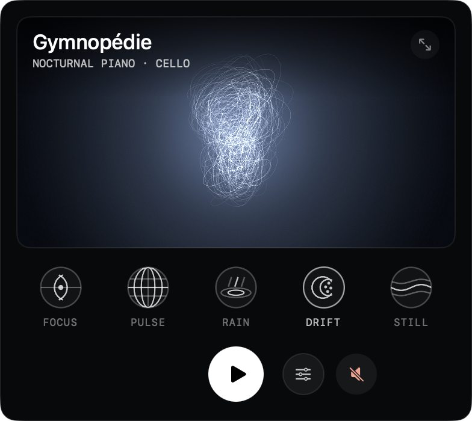
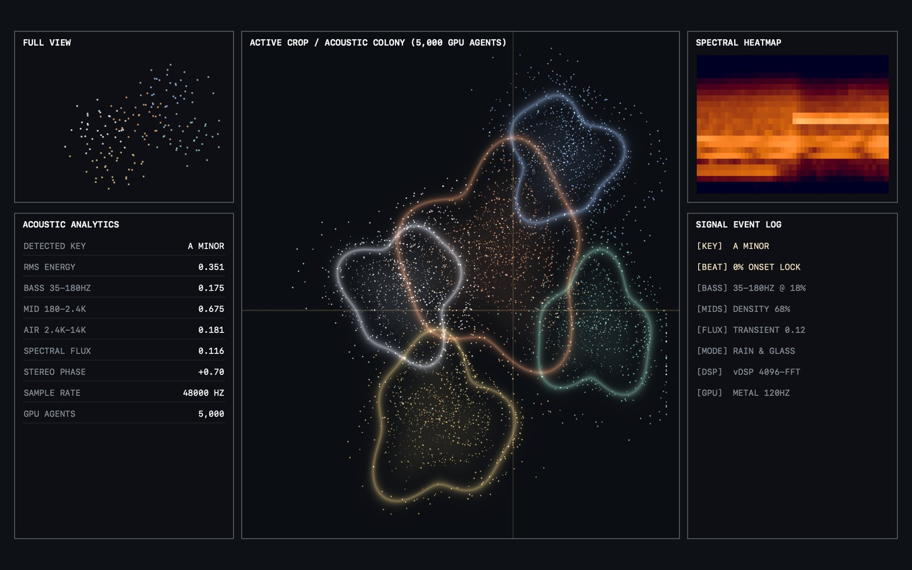
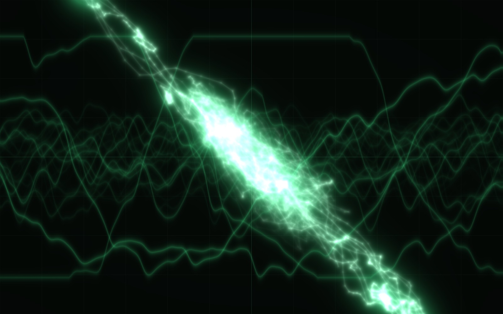
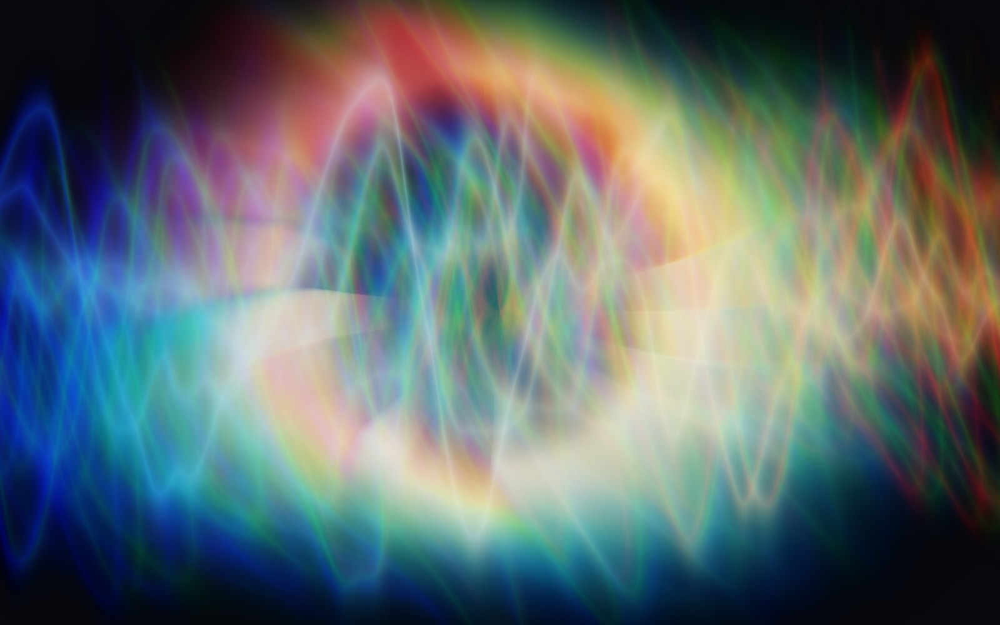

# Satie

Named after **Erik Satie**, who invented *musique d'ameublement* ("furniture music") in 1917 — sound meant to inhabit a room without demanding attention.

**Satie** is a native macOS **generative focus soundscape instrument** and **120Hz Metal visualizer** living quietly in your menu bar. Zero permissions required, zero subscriptions, zero cloud requests, zero third-party packages — **10 MB** native Swift 6 + Metal app with **46 studio-recorded CC0 acoustic samples** and real-time physical & granular synthesis, **Apple Developer ID signed & notarized**.

**Website & live preview:** [strangechances.com/satie](https://strangechances.com/satie/)

<p align="center">
  
</p>

## Install

### Homebrew
```bash
brew install --cask graemecode/tap/satie
```

### Direct Download
Download the notarized [Satie-3.1.0.dmg](https://github.com/graemecode/satie/releases/latest/download/Satie-3.1.0.dmg) (macOS 15 Sequoia or later, Apple Silicon), drag **Satie** to **Applications**, and launch. No macOS privacy prompts, no virtual audio drivers, no background daemons.

---

## Five Curated Soundscapes

Every mode runs 100% offline at **48 kHz stereo** on a lock-free, zero-allocation Core Audio render thread (`~3.6%` of one Apple Silicon core), evolving continuously over **Eno prime-length (5, 7, 11, 13-bar)** macro cycles with room-preserving reverb crossfades when switching modes:

| Mode | Title | Acoustic Palette |
| :--- | :--- | :--- |
| **FOCUS** | **Soft Light** | Felt upright piano, soft-mallet vibraphone, concert harp glints, bowed cello, live shimmer granular halo, tape echo, and an 8×8 modulated cedar chamber. |
| **PULSE** | **Kinetic Pulse** | 104 BPM D Dorian hypnotic analog synth (PolyBLEP ZDF filter sweeps), 56-mode physical modal resonators in 3D binaural orbit, phase-locked sub-kick, brushed micro-swung percussion. |
| **RAIN** | **Rain & Glass** | Real 48 kHz studio light-rain recording (3-second live equal-power crossfade loop) with friction-bowed wine glasses, soft vibraphone, and concert harp in F Lydian. |
| **DRIFT** | **Gymnopédie** | Slow 54 BPM nocturnal felt piano, Just-Intonation bowed cello swells, reverse-piano granular cloud, and generous *ma* negative space. |
| **STILL** | **Still** | Zero-melody suspended ambient pad and warm filtered noise cocoon designed for reading, writing, and long uninterrupted sessions. |

Inside the single **Options** drawer (`≡`), you can set a fade-out **Timer** (`∞ · 15m · 25m · 45m · 60m · 90m`) or layer gentle **Rain** or **Brown Noise** underneath any soundscape.

<p align="center">
  
</p>

---

## Four 120Hz Metal Visualizations

Hover over the visual canvas in the menu bar panel to glide between **Circuit · Ecology · Scope · Liquid**, tap the canvas to cycle, or press **`1`–`4`** in the Studio Window / Fullscreen Wall.

| 01 The Circuit | 02 Ecology Wall |
| :---: | :---: |
|  |  |
| 240-strand 3D curl-turbulence connectome + 3,200 neural spikes, 24-band sensor mosaic, curved Bézier impulse wires, and 4096-pt Circle of Fifths chromagram. | 5,000 stippled GPU colony agents across five frequency territories, with `FULL VIEW` minimap, `ACOUSTIC ANALYTICS`, scrolling thermal `SPECTRAL HEATMAP`, and `SIGNAL EVENT LOG`. |

| 03 Phosphor Scope | 04 Liquid Warp |
| :---: | :---: |
|  |  |
| True `RGBA16Float` ping-pong CRT Lissajous electron beam with velocity-modulated dwell glow, hairline graticule, and **P31 Emerald / P39 Amber** toggle. | 16-bit half-float ping-pong curl-noise HDR advection with bass-driven radial zoom, RGB chromatic dispersion, and ACES filmic tonemapping. |

---

## How It's Built

Satie is ~8,100 lines of **Swift 6** and **503 lines of Metal** (`Shaders.metal`) with **zero external dependencies** — built directly on `AVFoundation`, `Accelerate (vDSP)`, `Metal`, `MetalKit`, `MediaPlayer`, `Carbon`, `AppKit`, and `SwiftUI`.

```
Sources/
├── AcousticCore/                         # Pure Swift 6 audio engine & real-time DSP (no UI)
│   ├── Audio/
│   │   ├── SatieScore.swift              # Deterministic 32-bar composer + prime-length macro cycles
│   │   ├── FocusSoundEngine.swift        # Lock-free AVAudioSourceNode + 16-bar SPSC event queue
│   │   ├── StudioSampleBank.swift        # Parallel 48 kHz decoder for 46 CC0 samples + 4-pt Hermite sampler
│   │   ├── PhysicalInstruments.swift     # Felt piano, vactrol bells, analog ZDF synth, strings, groove engine
│   │   ├── ModularAlchemy.swift          # 56-mode modal resonator bank, 14-grain Beads cloud, 3D binaural bus
│   │   ├── DSPPrimitives.swift           # Cytomic SVF, RE-201 tape echo, 8×8 Hadamard FDN, vinyl mastering bus
│   │   ├── AcousticDSP.swift             # 4096-pt vDSP Hann FFT, 24 log bands, Krumhansl-Schmuckler key detector
│   │   ├── RingBuffer.swift              # Lock-free SPSC stereo ring buffer (audio -> Metal thread)
│   │   └── SystemOutputMute.swift        # Zero-permission read-only macOS output mute check
│   ├── HotKeys/GlobalHotKeys.swift       # Zero-permission Carbon global hotkeys (⌥⌘S, ⌥⌘Space, ⌥⌘], ⌥⌘M)
│   ├── Media/NowPlayingBridge.swift      # Control Center & AirPods media key integration (zero permissions)
│   └── Resources/Samples/                # 45 CC0-1.0 acoustic multi-samples + CC0 48 kHz studio rain bed
└── AcousticCircuit/                      # Native macOS app & 120Hz Metal renderer
    ├── Renderer/
    │   ├── Shaders.metal                 # 9 compiled Metal render pipelines (bgra8Unorm + rgba16Float ping-pong)
    │   ├── MetalVisualizerView.swift     # Triple-buffered MTKView (zero-copy Apple Silicon shared buffers)
    │   └── SchematicOverlayView.swift    # Retina CoreGraphics HUD layered over Metal in Studio/Fullscreen
    └── UI/
        ├── PopoverView.swift             # Notch-safe floating panel + hover-revealed frosted visual switcher
        ├── SoundscapeGlyphs.swift        # 5 custom 1px geometric vector emblems
        ├── StudioWindowController.swift  # Resizable Studio Window + Fullscreen Wall (⌘F)
        ├── MiniHUDWindow.swift           # Floating borderless corner monitor (⌘M)
        └── MenuBarIconView.swift         # Compact 22pt reactive menu bar meter
```

### Key Engineering Decisions
- **Real-time audio safety:** Zero heap allocations, zero locks, and zero Objective-C/Swift runtime dispatches on the Core Audio render thread. A producer fills a lock-free 16-bar SPSC ring queue (`LockFreeBarQueue`); the audio thread only consumes pre-composed bar events and reads `Synchronization.Atomic` parameters.
- **Studio-grade hybrid acoustics:** 45 CC0-1.0 multi-sampled zones (Versilian Studios VSCO-2 CE / VCSL felt upright piano, vibraphone, harp, cello, bowed wine glasses) + 1 mastered CC0 rain recording are decoded in parallel into 48 kHz `Float` arrays and played with 4-point Hermite cubic interpolation alongside physical modal resonators (56 parallel 2nd-order eigenmodes) and a 14-grain Hann-windowed granular cloud.
- **Mastering bus & room-preserving transitions:** Every soundscape runs through an 8×8 LFO-modulated Walsh-Hadamard FDN reverb and a 24 dB/oct elliptical vinyl-mastering bus (high-passing only the Side channel below 185 Hz for strict mono sub-bass, RMS optical glue, and a 2.5 ms lookahead true-peak limiter). Switching soundscapes dips only dry excitation for ~220 ms while preserving the FDN reverb tail and granular cloud so one room dissolves smoothly into the next.
- **Zero-copy Apple Silicon Metal rendering:** `AcousticMetalView` triple-buffers `AcousticUniforms` and 256-sample stereo waveform snapshots in `.storageModeShared` unified memory, driving 4 distinct GPU shader pipelines (`circuit`, `ecology`, `phosphor`, `liquid`) up to 120 Hz on ProMotion displays.
- **Zero macOS permissions:** Sandboxed with only `com.apple.security.app-sandbox`. No microphone, no system audio recording, no Accessibility, no AppleScript, and no network access.

---

## Controls & Shortcuts
- **Global Hotkeys (zero permissions):** `⌥⌘S` summon/dismiss panel · `⌥⌘Space` play/pause · `⌥⌘]` next soundscape · `⌥⌘M` mute Mac output.
- **Hardware Media Keys & AirPods:** Play/pause or skip soundscapes via macOS Control Center (`MPNowPlayingInfoCenter`).
- **Studio & Fullscreen:** `1`–`4` switch visualizations · `Space` play/pause · `⌘F` fullscreen · `⌘M` floating Mini HUD · `⌘W` close back to menu bar.

---

## Build from Source

```bash
# Run Swift Testing suite + build release .app
./scripts/build-app.sh

# Build, sign, install to /Applications, and launch
./scripts/build-app.sh --install

# Full Developer ID signed + Apple-notarized release DMG
./scripts/build-app.sh --release --install
```

## License

MIT — see [LICENSE](LICENSE). Bundled acoustic samples are CC0-1.0 public domain (Versilian Studios VSCO-2 CE, VCSL, and Wikimedia Commons).
