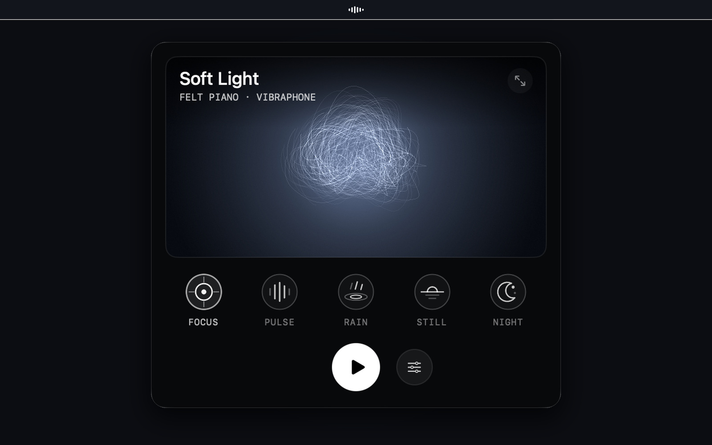
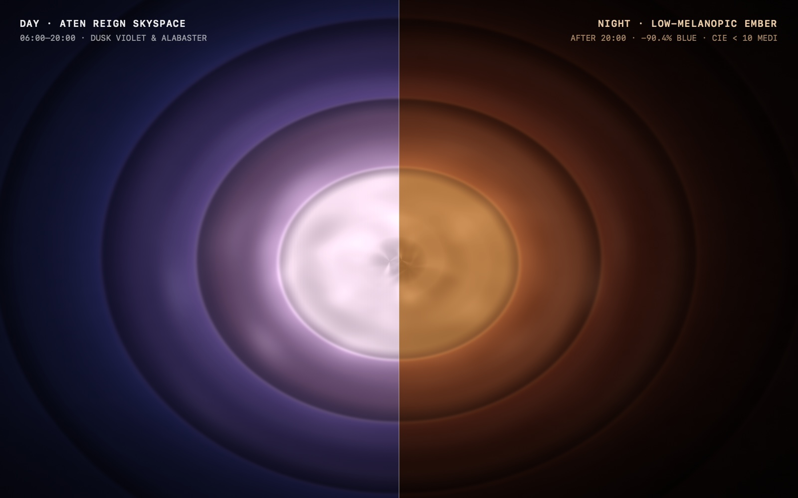
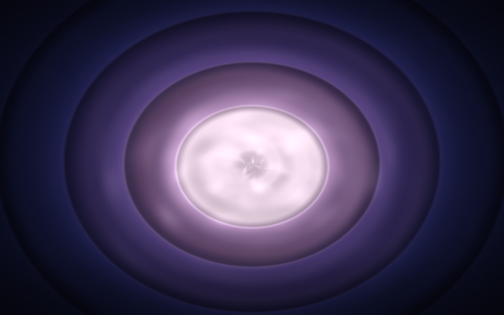
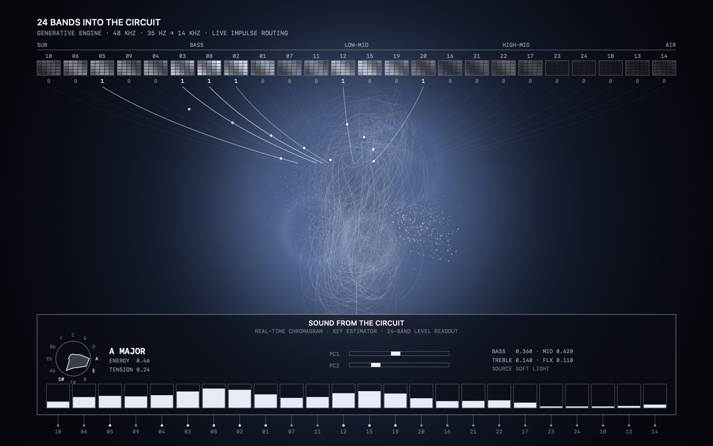
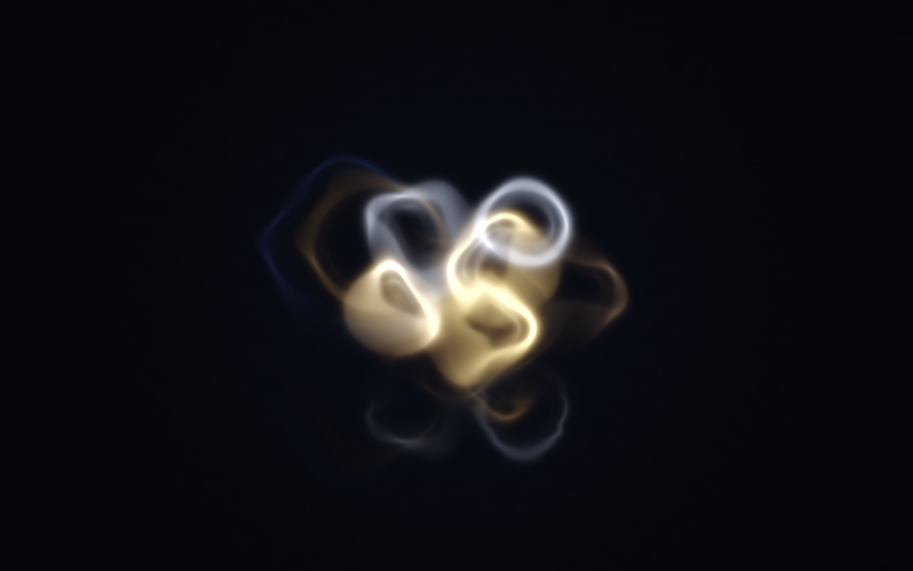
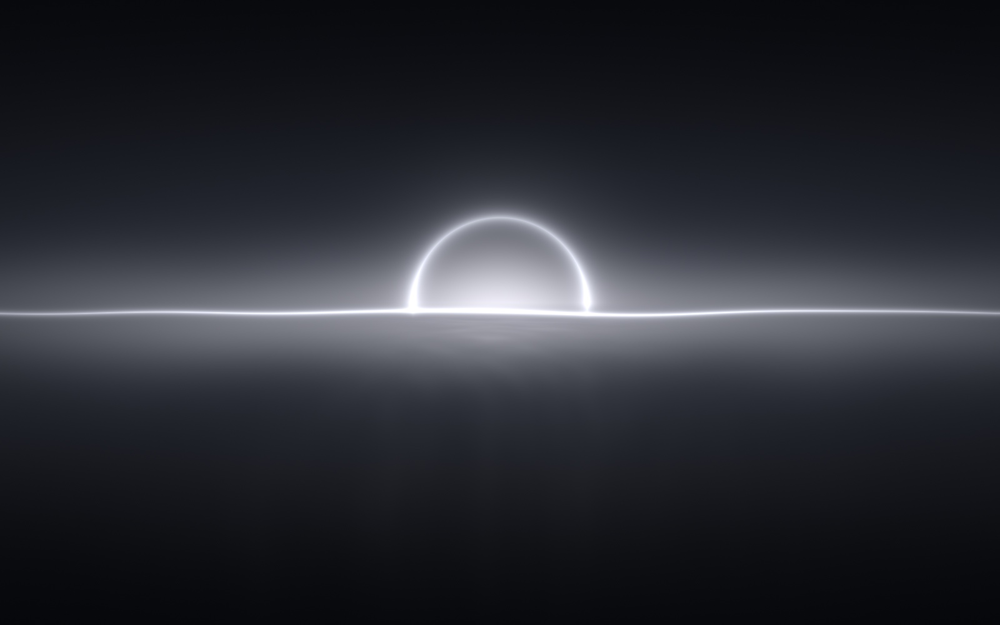

# Satie

Named after **Erik Satie**, who invented *musique d'ameublement* ("furniture music") in 1917 — sound meant to inhabit a room without demanding attention.

**Satie v4.1** is a native **Swift 6 + Metal** generative focus & meditation instrument and **120 Hz Apple EDR visualizer** living quietly in your macOS menu bar (with shared-core iPhone/iPad, Dynamic Island, StandBy, Apple Watch, Apple TV, and Vision Pro targets, natively localized in 8 languages: English, Japanese, French, Simplified Chinese, Taiwanese Traditional Chinese, Spanish, German, and Korean). Zero macOS permissions, zero subscriptions, zero network requests, zero third-party packages — **10 MB** Developer ID signed & Apple notarized `.dmg`.

**Website & live 6-world browser preview:** [strangechances.com/satie](https://strangechances.com/satie/)

<p align="center">
  
</p>

## Install

### Homebrew
```bash
brew install --cask graemecode/tap/satie
```

### Direct Download
Download the Apple-notarized [Satie-4.1.1.dmg](https://github.com/graemecode/satie/releases/latest/download/Satie-4.1.1.dmg) (macOS 15 Sequoia or later, Apple Silicon, 10 MB), drag **Satie** to **Applications**, and launch. No macOS privacy prompts, no virtual audio drivers, no background daemons.

---

## Six Generative Soundscapes

Every world synthesizes 100% offline at **48 kHz stereo** on a lock-free, zero-allocation Core Audio render thread (`1.4%–9.9%` measured single-core peak across all modes), evolving without audible loops via a linear-time **IRCAM Factor Oracle + Symbolic Constraint Grammar** and **Eno prime-length (5, 7, 11, 13-bar)** cycles:

| Mode | Title | Paired Visual | Acoustic Architecture |
| :--- | :--- | :--- | :--- |
| **FOCUS** | **Soft Light** | `01 The Circuit` | 72 BPM A major *kankyō ongaku*: studio felt upright piano, soft-mallet vibraphone, concert harp glints, bowed cello, shimmer granular halo, tape echo, and a Velvet-Noise FDN cedar chamber. |
| **PULSE** | **Kinetic Pulse** | `03 Phosphor Scope` | 108 BPM D Dorian flow momentum: creamy PolyBLEP ZDF sweeps (`< 2.75 kHz`) fused with CC0 vibraphone, beat-locked `14.40 Hz` beta shimmer (`+11.26 dB` SNR, `2.82%` silky roughness), `16 ms` optical sidechain (`-1.4 dB`), and a soft `60 Hz` felt kick. |
| **RAIN** | **Rain & Glass** | `02 Ecology Wall` | F Lydian Kyoto courtyard garden: non-repeating `StochasticRainField` (`8.2×` lower 10 s autocorrelation than a loop, `r = 0.074`) with friction-bowed wine glasses, soft vibraphone, and concert harp. |
| **STILL** | **Still** | `05 Horizon` | Zero-melody suspended A sus9 pad and warm velvet brown-noise cocoon built for dense reading and writing. |
| **DIVE** | **Deep Dive** | `06 Oculus` | Evidence-based meditation engine: `8.5 → 5.5 bpm` vagal breath descent (`42%` inhale / `58%` exhale), bowed acoustic cello drone (`D2 + A2`), non-repeating rain, resonant bronze singing bowls, and subtle post-matrix binaural depth cue. |
| **NIGHT** | **Gymnopédie** | `04 Nocturne Silk` | 54 BPM nocturnal felt piano, Just-Intonation bowed cello swells, reverse-piano granular cloud, and generous *ma* negative space. |

Inside the single **Options** drawer (`≡`), set a fade-out **Timer** (`∞ · 15m · 25m · 45m · 60m · 90m`), optionally layer **Rain** or **Brown Noise** underneath any world (off by default), or pin any of the six visualizations.

---

## Six 120 Hz Apple EDR Visualizations

Every shader renders natively in **16-bit half-float Apple EDR** (`rgba16Float` + `extendedLinearDisplayP3`) with **`64×64` Ulichney Void-and-Cluster spatiotemporal blue-noise dithering** (`+44.44 dB` high-pass DFT) for zero OLED dark-gradient banding. After **20:00 local time**, all six visuals automatically shift into a **low-melanopic 2200 K ember spectrum** (`−90.4%` blue emission in `06 Oculus`, targeting CIE `< 10` mEDI).

<p align="center">
  
</p>

| 06 Oculus | 01 The Circuit |
| :---: | :---: |
|  |  |
| James Turrell *Aten Reign* skyspace breathing at `5.5 bpm` with Faraday bowl caustics and automatic post-20:00 ember shift. | 240-strand 3D optical-fiber connectome + 3,200 spikes, 24-band sensor mosaic, curved Bézier impulse wires, and 4096-pt Circle of Fifths chromagram. |

| 02 Ecology Wall | 03 Phosphor Scope |
| :---: | :---: |
|  |  |
| Kyoto courtyard rain ripples + 5,000 stippled GPU colony agents with minimap, acoustic analytics, thermal spectrogram, and signal event log. | Smooth 255-segment `RGBA16Float` ping-pong CRT Lissajous beam with velocity-modulated dwell glow and **P31 Emerald / P39 Amber** toggle. |

| 04 Nocturne Silk | 05 Horizon |
| :---: | :---: |
|  |  |
| Candlelit amber gold and moon-silver sumi-e ink rings triggered by live piano & cello notes over dark mirrored water. | Sugimoto / Rothko nocturnal horizon line, calm lunar dome, and perspective moonlight water caustics. |

---

## Architecture & Formal Verification

Satie is ~15,500 lines of **Swift 6** and **1,133 lines of Metal** (`Shaders.metal`, **11 compiled pipelines**) with **zero external packages**:

```
Sources/
├── AcousticCore/                         # Shared Swift 6 audio, DSP, formal state & math (zero UI)
│   ├── Audio/
│   │   ├── HarmonicFactorOracle.swift    # O(m) IRCAM Factor Oracle + Symbolic Constraint Grammar
│   │   ├── SatieScore.swift              # Curated harmonic DNA + Eno 5/7/11/13-bar prime cycles
│   │   ├── DeepMeditationEngine.swift    # Vagal breath descent, stochastic rain, bowls, cello drone
│   │   ├── HRVResonanceController.swift  # Closed-loop on-device HRV breathing resonance controller
│   │   ├── FocusSoundEngine.swift        # Lock-free AVAudioSourceNode + 16-bar SPSC event queue
│   │   ├── DSPPrimitives.swift           # 32-tap Velvet-Noise ER + colorless 8×8 FDN + mastering bus
│   │   ├── StudioSampleBank.swift        # Parallel 48 kHz decoder (46 CC0 files) + 4-pt Hermite sampler
│   │   ├── PhysicalInstruments.swift     # Felt piano, PolyBLEP ZDF synth, 14.4 Hz shimmer, strings
│   │   ├── ModularAlchemy.swift          # 56-mode modal resonator bank, 14-grain Beads cloud, 3D binaural
│   │   ├── AcousticDSP.swift             # 4096-pt vDSP Hann FFT, 24 log bands, Krumhansl key detector
│   │   └── RingBuffer.swift              # Lock-free SPSC stereo ring buffer (audio -> Metal thread)
│   ├── BlueNoise64.swift                 # 64×64 Ulichney Void-and-Cluster spatiotemporal blue noise
│   ├── StudioLifecycleMachine.swift      # TLA+/TLC formally verified Studio MTKView state machine
│   ├── GlobalHotKeys.swift               # Zero-permission Carbon hotkeys (⌥⌘S, ⌥⌘Space, ⌥⌘], ⌥⌘M)
│   └── Media/NowPlayingBridge.swift      # Control Center & AirPods media keys (zero permissions)
├── AcousticCircuit/                      # Native macOS app & 120 Hz Apple EDR Metal renderer
│   ├── App/SatieAppIntents.swift         # Native Apple Shortcuts, Siri, Spotlight & Focus Filters
│   ├── Renderer/Shaders.metal            # 11 compiled Metal pipelines (rgba16Float EDR + blue noise)
│   ├── Renderer/MetalVisualizerView.swift# Native CAMetalLayer + CAMetalDisplayLink (zero-copy EDR)
│   ├── Renderer/SchematicOverlayView.swift# Retina CoreGraphics HUD layered over Metal
│   └── UI/                               # PopoverView (6 geometric glyphs), Studio, MiniHUD, MenuBarIcon
├── SatieiOS/ & SatieWidgets/             # iOS 18+ app, Dynamic Island Live Activities & OLED StandBy
├── SatieWatch/                           # watchOS 11+ Taptic Breath & on-device HealthKit HRV biofeedback
├── SatieTV/                              # tvOS 18+ 4K EDR living-room skyspace
└── SatieVision/                          # visionOS 2+ spatial sanctuary
```

### Key Engineering & Verification Highlights
- **Real-time audio safety:** Zero heap allocations, zero locks, and zero runtime dispatches on the Core Audio render thread (`LockFreeBarQueue` + Swift 6 `Synchronization.Atomic`).
- **Colorless Velvet-Noise acoustics:** 32-tap zero-DC Optimal Velvet-Noise early-reflection diffuser (`19.5%` echo density, `-0.014` early stereo correlation) feeding a delay-proportional colorless 8×8 orthogonal FDN (`DC = 0.000003`, `0.761` tail flatness) and 24 dB/oct elliptical vinyl-mastering bus.
- **Infinite non-repeating form:** Linear-time *O(m)* IRCAM Factor Oracle + Symbolic Constraint Grammar verified across 256-bar runs (`7/7` unique 32-bar passes, `100%` key purity).
- **Formally verified rendering lifecycle:** `StudioLifecycleMachine` was modeled in **TLA+** and checked exhaustively with **TLC** (`0` violations across `6` safety/liveness invariants), eliminating frozen Studio `MTKView` display links across Space switches and system wake.
- **Zero macOS permissions:** Sandboxed with only `com.apple.security.app-sandbox`. No microphone, no audio capture, no Accessibility, and no network access.

---

## Controls & Automation
- **Global Hotkeys (zero permissions):** `⌥⌘S` summon/dismiss panel · `⌥⌘Space` play/pause · `⌥⌘]` next world · `⌥⌘M` mute Mac output.
- **Apple Shortcuts, Siri & Focus Filters:** Native `AppIntents` (`Start Soundscape`, `Pause Satie`, `Focus Filter` automatic soundscape pairing).
- **Hardware Media Keys & AirPods:** Play/pause or skip worlds via macOS Control Center (`MPNowPlayingInfoCenter`).
- **Studio & Fullscreen:** `1`–`6` switch visualizations · `Space` play/pause · `⌘F` fullscreen · `⌘M` floating Mini HUD · `⌘W` close back to menu bar.

---

## Build & Verify from Source

```bash
# Run all 21 release DSP / Factor Oracle / TLA+ tests
swift test -c release

# Build release .app bundle
./scripts/build-app.sh

# Build, sign, install to /Applications, and launch
./scripts/build-app.sh --install

# Full Developer ID signed + Apple-notarized release DMG
./scripts/build-app.sh --release --install
```

## License

MIT — see [LICENSE](LICENSE). Bundled acoustic samples are CC0-1.0 public domain (Versilian Studios VSCO-2 CE, VCSL, and Wikimedia Commons).
